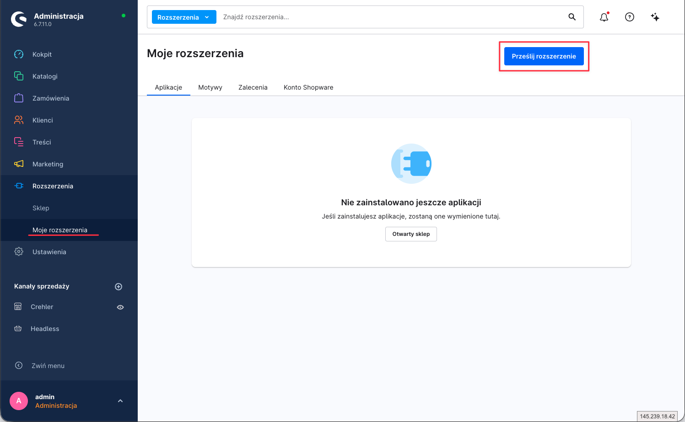
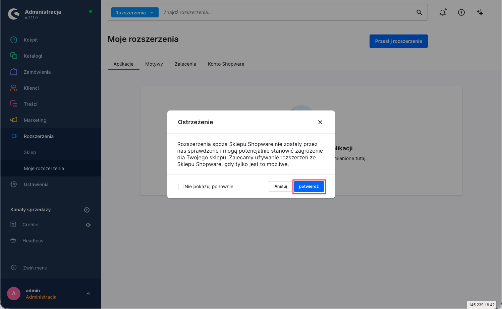
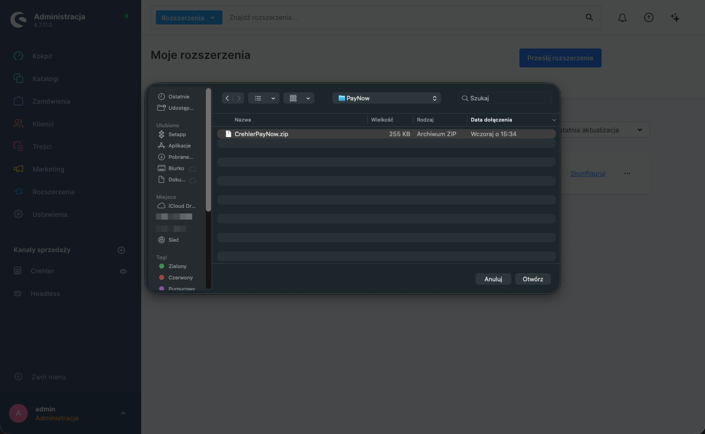
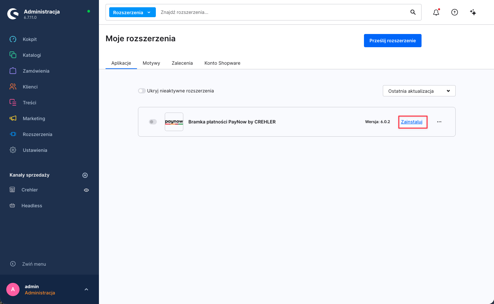

<p align="center">
  
</p>

<h1 align="center">Instrukcja instalacji</h1>

<p align="center">Wtyczkę <strong>Bramka płatności PayNow</strong> zainstalujesz na dwa sposoby: przez Composer albo z paczki ZIP.</p>

---

## Wymagania

| Komponent | Wersja |
|---|---|
| Shopware | 6.6.x lub 6.7.x |
| PHP | 8.2, 8.3, 8.4 lub 8.5 |
| Konto PayNow | aktywne, z dostępem do kluczy API (Klucz API + Klucz obliczania podpisu) |
| Waluta | sklep musi obsługiwać **PLN** |

---

## Metoda 1 — Composer (zalecana)

**1. Zainstaluj wtyczkę:**

```bash
composer require crehler/pay-now
```

**2. Aktywuj w Shopware:**

```bash
bin/console plugin:refresh
bin/console plugin:install --activate CrehlerPayNowPayment
bin/console cache:clear
```

**3.** Wtyczka pojawi się w **Rozszerzenia → Moje rozszerzenia** jako *„Bramka płatności PayNow"*.

➡️ Przejdź do **[Instrukcji konfiguracji](konfiguracja.md)**.

---

## Metoda 2 — Paczka ZIP

**1.** Pobierz wtyczkę **[CrehlerPayNowPayment.zip](https://github.com/crehler/pay-now/releases/latest/download/CrehlerPayNowPayment.zip)**.

**2.** W **Rozszerzenia → Moje rozszerzenia** kliknij **„Prześlij rozszerzenie"**.



**3.** Potwierdź ostrzeżenie o rozszerzeniu spoza Sklepu Shopware — kliknij **„potwierdź"**.



**4.** Wskaż pobrany plik **`CrehlerPayNowPayment.zip`**.



**5.** Wtyczka pojawi się na liście jako *„Bramka płatności PayNow"* — kliknij **„Zainstaluj"**, a następnie **„Aktywuj"**.



➡️ Przejdź do **[Instrukcji konfiguracji](konfiguracja.md)**.

---

## Aktualizacja z wersji 4.x

Wersja 6 to nowa wtyczka pod tą samą nazwą — Shopware zaproponuje ją jako zwykłą aktualizację.
Podczas aktualizacji wtyczka:

- **wyłącza starą metodę płatności „paynow"** — zostaje w systemie, bo odwołują się do niej
  wcześniejsze zamówienia, ale nie jest już oferowana klientom;
- **przenosi klucze API** — jeśli w 4.x był włączony tryb sandbox, klucze trafiają do pól
  sandbox, w przeciwnym razie do pól produkcyjnych.

Po aktualizacji:

1. Przypisz nowe metody płatności (BLIK, przelew bankowy, karta, PayPo) do kanałów sprzedaży
   w **Ustawienia → Kanały sprzedaży** i zmień domyślną metodę płatności, jeśli była nią stara „paynow".
2. Sprawdź konfigurację wtyczki i kliknij **„Testuj połączenie"**.
3. W panelu PayNow ustaw adresy powiadomień podane w konfiguracji wtyczki — zmieniły się względem 4.x.

---

## Wsparcie

Problem z instalacją? Napisz do nas: **[support@crehler.com](mailto:support@crehler.com)**

<p align="center"><sub>Bramka płatności <strong>PayNow</strong> · <a href="https://crehler.com/">crehler.com</a></sub></p>
